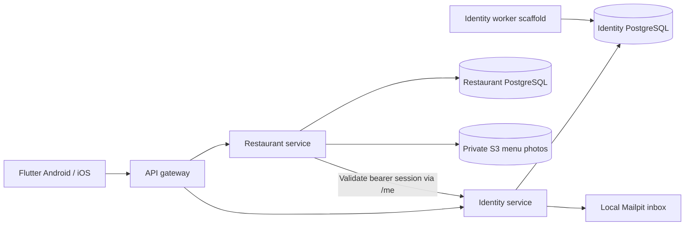

# Microservice architecture

## Day 10 additions

The driver service now runs a separate dispatch worker that owns ranking, sequential offers and reservations in the driver database. Private HTTP discovery and idempotent confirmation connect it to the orders service. The order database independently enforces one assignment per order/driver. Ambiguous confirmations retain the reservation and are surfaced to operations. See [Day 10](day-10-dispatch.md); no cross-service SQL joins or shared database credentials are used.

## Day 9 additions

`apps/drivers` owns driver onboarding, approval, availability, latest GPS fixes, foreground notification registration and offer reservations in an independent PostgreSQL database. Gateway routes `/driver`, `/driver-admin` and `/drivers-health` to port 3004. Authentication is verified against identity `/me`; legacy identity driver approval is not delivery eligibility. Internal offer creation uses a separate service token and is blocked at the public gateway. See [Day 9](day-09-drivers.md).

Since the Day 4 baseline below, `apps/orders` (3002) added immutable checkout snapshots, payment coordination, outbox processing and restaurant fulfillment; `apps/payments` (3003) added simulated/test payment attempts and reconciliation. Both own separate PostgreSQL databases. Day 10 will connect dispatch to the new driver service. No cross-service database access is introduced. The following Day 4 notes are historical, not the current feature-completion status; see progress.md for verified milestones.

The user requested microservices, Docker and Kubernetes, replacing the original single-backend plan. Day 3 adds an independently deployable restaurant service. Hosting and production remain deferred.

Implemented service topology:

- `apps/api` is the identity service. It owns accounts, sessions, driver approval identities and identity audit events. Day 2's restaurant directory remains legacy compatibility data only.
- `apps/restaurants` owns restaurant profiles, membership, schedules, approval history, menu categories/items/photo references and its own database. Membership and current identity are checked on every protected operation. It has no identity database access. Menus use the restaurant domain rather than a separate service with shared tables.
- Photo bytes live in private S3-compatible storage (SeaweedFS for local development). Only the restaurant service reads/writes objects. The API decodes and re-encodes uploads and exposes photos only through authorized routes; clients never receive bucket credentials or object keys.
- `apps/gateway` is an independently deployable Nginx API gateway. It routes catalog/onboarding/restaurant-admin traffic to restaurants, other current routes to identity, blocks internal endpoints, and overwrites client-supplied forwarded-address headers.
- The worker is a separate process from the identity image; it still only checks database readiness. It does not claim to deliver notifications or process events yet.
- Each implemented business service has its own PostgreSQL instance, credentials and migrations. There are no cross-service database joins or foreign keys. User IDs in restaurant membership are opaque identity references.
- Mailpit is a local development dependency for recovery email capture; it is not a production mail provider.

Planned work for later days: orders, payments, dispatch/delivery, and notifications/settlements as needed. Each new service will own its data and expose explicit contracts. The future order engine must validate current restaurant/menu eligibility at acceptance and store purchase-time item/price snapshots. Archived menu IDs remain stable; they are not historical price snapshots. No orders are accepted yet.

`TRUST_GATEWAY=true` is enabled only in the supplied private container topology, where identity is reached through the gateway. Do not expose identity directly with this setting. Kubernetes NetworkPolicy requires a supporting network plugin; otherwise the policy has no effect. Future production ingress, TLS, gateway trust, secret rotation, image digest pinning, scaling and backup settings will be selected when hosting is configured.
